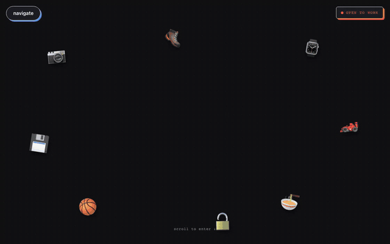

# alyananwar.github.io

**My portfolio site. Hand-written HTML, CSS, and JavaScript, no framework, hosted on GitHub Pages.**

<p align="center">
  
</p>

**Live:** [alyananwar.github.io](https://alyananwar.github.io)

I'm a Computer Science student at the University of the Pacific. This site has my projects, experience, certifications, and resume. Each project has its own case study page under `projects/`.

## What's in it

- **Liquid-metal name** on the landing screen, a WebGL2 shader adapted from [paper-design/liquid-logo](https://github.com/paper-design/liquid-logo). If WebGL2 isn't available it falls back to a dot-matrix version.
- **Light and dark themes** with a toggle.
- **Project case studies** for TigerTrack, EasyReview, GiveLedger, CyberPartner, a network pentest, and more.
- **"Connect with me" form** and visit tracking, backed by a small Cloudflare Worker I wrote (`net.js`, `connect.js`).

## Run it locally

There's no build step, so any static server works:

```bash
git clone https://github.com/alyananwar/alyananwar.github.io && cd alyananwar.github.io && python3 -m http.server 8000
```

Then open http://localhost:8000.

## Files

| File | What it does |
|---|---|
| `index.html`, `style.css`, `script.js` | The main page, styles, scroll animations, and theme toggle |
| `liquid-name.js` | WebGL name shader |
| `net.js`, `connect.js` | Visit tracking and the contact form, both talk to the Worker |
| `projects/` | One page per project |
| `images/` | Screenshots and project photos |
